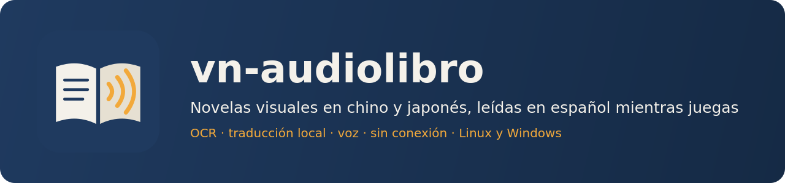
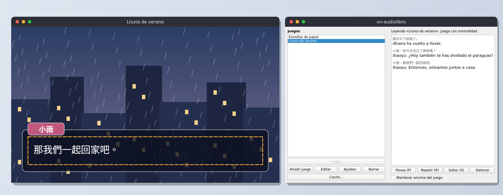

<p align="center">
  
</p>

<p align="center">
  <a href="https://github.com/v1kz25/visualnovel-traductor/actions/workflows/ci.yml"></a>
  <a href="https://github.com/v1kz25/visualnovel-traductor/releases/latest"></a>
  <a href="LICENSE"></a>
  
</p>

# vn-audiolibro

**Español** · [English](README.en.md)

Audiolibro en español, en tiempo real, para novelas visuales en chino y japonés.



<sub>Escena de ejemplo dibujada para esta imagen; no pertenece a ningún juego.</sub>

Mientras juegas, la app lee el texto de la ventana del juego, lo traduce al español (o al inglés, francés, portugués, alemán o italiano, si lo eliges para ese juego) y lo reproduce con voz. Todo funciona en tu equipo: sin cuentas, sin coste y sin conexión (salvo para descargar los modelos la primera vez y, si lo aceptas, para avisarte de versiones nuevas).

> Última versión: **v0.3.0**, para Linux y Windows.

## Cómo funciona

1. Eliges la ventana del juego y dibujas un recuadro sobre la zona del texto (una vez por juego).
2. La app detecta cuándo aparece texto nuevo, lo reconoce con OCR y lo traduce con un modelo local.
3. Oyes la traducción con voz sintética y la ves en la ventana de la app. Lo ya traducido queda en caché.

## Requisitos

- **Linux** x86_64 con una sesión **X11** (no Wayland) y PulseAudio o PipeWire, con `paplay`
  (paquete `pulseaudio-utils`).
- **Windows** 10 u 11 de 64 bits.
- Unos 2 GB libres en disco para los componentes que se descargan la primera vez.
- 8 GB de RAM recomendados.

## Instalación

### Linux

Descarga el AppImage de la última versión en [Releases](../../releases) y:

```bash
chmod +x vn-audiolibro-*.AppImage
./vn-audiolibro-*.AppImage
```

La primera vez descarga los componentes que necesita (unos 1,2 GB) mostrando su licencia y el
progreso. Después funciona sin conexión. Desde la terminal: `./vn-audiolibro-*.AppImage --help`.

### Windows

1. Descarga `vn-audiolibro-X.Y.Z-windows-x64.zip` de la última versión en [Releases](../../releases).
2. Descomprímelo donde quieras (por ejemplo, en `Documentos`). No necesita instalación.
3. Abre `vn-audiolibro.exe`. La primera vez te ofrece añadirlo al menú Inicio (también con
   `vn-audiolibro-consola.exe instalar-acceso`).

El ejecutable no está firmado, así que la primera vez Windows SmartScreen puede avisar de que
«Windows protegió su PC». Pulsa **Más información** y después **Ejecutar de todas formas**.

Para usar la app desde la terminal está `vn-audiolibro-consola.exe` (por ejemplo,
`vn-audiolibro-consola.exe --help`). Los componentes descargados, los juegos y la caché se guardan
en `%LOCALAPPDATA%\vn-audiolibro` y los ajustes en `%APPDATA%\vn-audiolibro`.

## Uso

1. **Añadir juego**: elige la ventana del juego, captúrala y dibuja un recuadro sobre la caja de texto.
   Ahí se elige también el idioma de la traducción y de la voz: español (por defecto), inglés,
   francés, portugués, alemán o italiano. La voz de cada idioma (unos 60-80 MB) se descarga la
   primera vez que se usa; ver [Voces](#voces).
   El nombre de quien habla no se lee en voz alta: se muestra delante de la traducción. La app lo
   reconoce al principio de la línea (`Nombre：texto`, `【Nombre】texto` o `Nombre「texto」`) o, si el
   juego lo pone en una caja aparte, en la **Zona del nombre** que dibujes. Cada nombre se traduce
   una vez y se guarda en el glosario del juego, donde puedes corregirlo.
2. **Jugar**: la app lee cada línea nueva, la traduce y la dice en voz alta mientras juegas.
3. **Ajustes**: voz (mujer u hombre) y velocidad, cómo leer cuando avanzas deprisa, volumen del juego
   y de otras aplicaciones, y glosario de nombres propios. En **Personajes** aparecen los que ya han
   hablado y puedes darle a cada uno voz de mujer u hombre; los demás usan la voz del juego.

**Jugar con una sola pantalla.** Con los subtítulos activados en los ajustes del juego, marca
**Solo subtítulos: minimizar la app al jugar**: al pulsar Jugar, la app se minimiza y sobre el juego
solo queda la traducción. La partida se controla sin salir del juego con atajos de teclado globales:
Ctrl+Alt+P (pausar o seguir), Ctrl+Alt+R (repetir), Ctrl+Alt+S (saltar) y Ctrl+Alt+H (mostrar u
ocultar los subtítulos). Mientras juegas, el juego no recibe esas combinaciones: si alguna choca con
las suyas, cámbiala o desactívalos en **Atajos de teclado…**. En Linux funcionan con X11. También
puedes usar el ratón: al pasarlo por los subtítulos aparecen botones para pausar, repetir, saltar
y ocultarlos. Si los ocultas, queda una marca pequeña en su lugar; al pasar el ratón por ella
vuelven los botones, también el de mostrarlos. Debajo del texto, los subtítulos dicen cuántas líneas
quedan por leer o, cuando la voz termina, «✓ Leída · puedes avanzar».

**Juegos con el guion legible.** Algunos juegos guardan su guion en ficheros de texto (por ahora,
los hechos con Unity que lo tienen en `StreamingAssets/Scripts` con órdenes `OutputLine`). Al
añadirlos, la app encuentra el guion sola o puedes elegir su carpeta en **Guion del juego**. Así el
texto sale exacto del guion aunque el OCR falle, el OCR solo sirve para saber por dónde vas, y los
párrafos siguientes se traducen por adelantado mientras escuchas el actual. Si el guion trae una
traducción oficial al inglés, puedes traducir desde ella. Para traducir el guion entero antes de
jugar, elige el juego y pulsa **Traducir el guion…** (o, en la terminal,
`vn-audiolibro traducir-guion "Mi juego"`): muestra el progreso y lo que falta, y se puede parar y
seguir otro día.
La app solo lee los ficheros del juego: no los modifica.

**Traducir con Gemini (opcional).** En el editor de cada juego se puede elegir Gemini, de Google, en
lugar del traductor local, con tu propia clave gratuita de Google AI Studio (se guarda en el
llavero del sistema). El texto del juego se envía a Google. Si Gemini falla o se agota su límite,
esa línea se traduce en local. Al traducir el guion entero, Gemini traduce muchas líneas en cada
petición para que quepa en el límite diario del plan gratuito; si se agota, se sigue otro día.

La interfaz está en español y en inglés: sigue el idioma del sistema y se puede cambiar en
**Idioma de la app**, en la ventana principal.

## Desarrollo

```bash
uv sync
uv run vn-audiolibro
uv run pytest
uv run ruff check
empaquetado/construir_appimage.sh   # AppImage en build/appimage (necesita libxcb-cursor0)
empaquetado/construir_windows.sh    # zip portable en build/windows (en Windows, con Git Bash)
uv run python herramientas/imagenes_readme.py   # regenera el banner y las capturas de .github/assets
uv run python -m vn_audiolibro.textos en        # pone al día el catálogo en inglés (o crea el de otro idioma)
```

Los textos de la interfaz se escriben en español marcados con `_()` y cada idioma tiene su catálogo
`.po` en `src/vn_audiolibro/textos/`. Un test falla si algún texto marcado no está traducido.

## Contribuir

Los errores y las propuestas se abren como [issues](../../issues/new/choose). Si quieres enviar un
cambio, lee antes [`CONTRIBUTING.md`](CONTRIBUTING.md).

## Voces

Todas son voces de [Piper](https://github.com/rhasspy/piper-voices) con licencia libre (sin
restricción de uso no comercial). La app no las incluye: las descarga del repositorio oficial y
comprueba su SHA-256.

| Idioma | Mujer | Hombre | Licencia de los datos |
|---|---|---|---|
| Español | sharvard (F) | sharvard (M) | CC BY 3.0 |
| Inglés | kristin | john | Dominio público (LibriVox) |
| Francés | upmc (jessica) | upmc (pierre) | CC BY-SA 4.0 |
| Portugués (Brasil) | faber | faber | CC0 |
| Alemán | kerstin | thorsten | CC0 |
| Italiano | paola | paola | CC0 |

En portugués e italiano no hay una segunda voz de calidad con licencia libre, así que una sola lee
a todos los personajes.

## Licencia

GPL-3.0-or-later. Ver [`LICENSE`](LICENSE).
